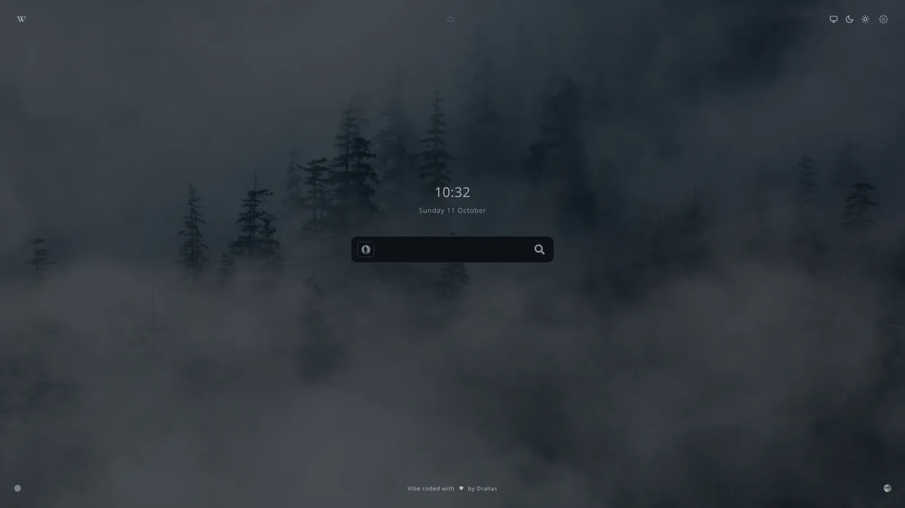

<h1 align="center">Minimal-StartPage</h1>

  A minimal start page with search, a clock, optional weather, links and a light, dark or system theme.
  Everything beyond the search is switched on in the settings.

  <a href="https://drallas.github.io/Minimal-StartPage/"><strong>Open the start page</strong></a>
  &nbsp;·&nbsp;
  <a href="Installation.md"><strong>Install it on your computer</strong></a>
  &nbsp;·&nbsp;
  <a href="docs/FAQ.md"><strong>Questions and answers</strong></a>

---

<table>
  <tr>
    <td align="center">
      
       
      <b>Standard page, light theme</b>
    </td>
  </tr>
  <tr>
    <td align="center">
      
       
      <b>Standard page, dark theme</b>
    </td>
  </tr>
</table>

<table>
  <tr>
    <td align="center" width="25%">
      
       
      <b>Misty forest</b>
    </td>
    <td align="center" width="25%">
      
       
      <b>Pink dunes</b>
    </td>
    <td align="center" width="25%">
      
       
      <b>Mountain haze</b>
    </td>
    <td align="center" width="25%">
      
       
      <b>No image, blue tint</b>
    </td>
  </tr>
</table>

---

## Features

Everything is optional. The settings start with a choice of page:

**Minimal** shows only the search and the clock, plus the colour button at the bottom left. **Standard** adds the date.

**Standard** is the default. It adds the Wikipedia button, the colour button at the bottom left and the wallpaper button at the bottom right. The AI shortcuts, time zones and the rest are there to discover in the settings.

Each option can still be changed on its own. When your choices match neither page, the page shows **Personal**. A page never switches weather or your IP address on, since they send data.

- **Search.** Type a query and press Enter, or click the magnifier. It opens in the same tab; under **Advanced** you can choose a new tab instead. The icon on the left shows the search engine; click it to switch between DuckDuckGo (the default), Kagi, Brave and Google. Your choice is remembered.

- **Clock.** The time sits above the search bar, with the date underneath. Click the time to cycle through 24-hour, 12-hour (AM/PM) and full time with seconds, or choose the format under **Advanced**. The colons stay still. Hover over the time to see your time zone and its UTC offset.

- **Time zones.** Optional. A small clock icon above the time opens up to five extra time zones, each with its UTC offset and a day difference when it is not today. **Edit time zones** in that window is where you change them.

- **Date.** Hover over the date for the ISO week and the day of the year. Click it to switch between the long form and a short numeric date, in the order of your browser. Under **Advanced** you can choose the order (day-month-year, month-day-year or year-month-day) and whether the date is long or short; the choices and clicking the date stay in step. The date follows your browser's language.

- **Quote.** Optional. A short quote from a philosopher or teacher, changing every six hours, in your browser's language. Click it for the next one.

- **Links.** The globe at the top left opens a Links window. It shows the permanent links as icons (Wikipedia, Google, Reuters, Apple, Microsoft, GitHub, Facebook, Instagram, X and Reddit) and your own links below, each with an optional description. **Edit links** takes you to where you add, order and edit them; you can keep up to 15. Hover the globe to see your own links. With **Own links** off, the globe is a plain Wikipedia link in your browser's language.

- **AI shortcuts.** Shortcuts below the search bar. In **Manage data** you tick the AI services you want: Claude, ChatGPT, Grok, Duck.ai, Lumo, Kagi and Meta AI. Up to five in total, your own shortcuts included, in any order, or none at all. Each shortcut shows its service icon, and the links open in a new tab by default (change this under Advanced).

- **Weather.** Optional, off by default. Up to five extra places can be added, shown as chips in the forecast window. Typing a city suggests matches, so you can pick the right one. Hover over the temperature for a short preview of the next six hours; click it for the full forecast, with the next seven days and a link to Windy.

- **IP details.** A button in the settings shows the last IP address you asked for, with the city, provider and more. It is checked only when you press the check button, or when the weather uses your IP location.

- **Background.** The round button at the bottom right steps through the backgrounds: none, then each wallpaper you have switched on, and back again. The button at the bottom left changes the background colour in steps. In Data beheren, the Background tab shows the wallpapers and lets you switch each one on or off. The tint can be switched off, and the background adapts to light and dark mode.

- **Settings and help.** Open the settings with the gear at the top right, or press `?`. The basic view has the pages and the privacy note. **Advanced** opens the rest, grouped into Weather, Show, Time format, Date, Search, AI shortcuts, Background and Language. Under **Language** in the Advanced settings you can choose the page language; **Automatic** follows your browser. The **Help** button opens a guide to every feature. Press `Esc` to close.

- **Phones.** The bottom controls sit above the browser's bar, and the layout fits landscape phones too.

- **Hidden details.** A few small details are tucked away in the page. Look closely and explore.

---

## Use it

There are three ways to use it, from easiest to most control. You do not need to install anything for the first one.

1. **Use the online version.** Open [the start page](https://drallas.github.io/Minimal-StartPage/), bookmark it and set it as your homepage. On a phone, in Safari, tap Share and then Add to Home Screen.

2. **Install a copy on your computer.** The page then works offline; only searches and the AI links need an internet connection. Download the files, unzip them, open `index.html` and set it as your homepage. Step-by-step instructions for Windows and macOS are in [Installation.md](Installation.md).

3. **Use Git.** If you already work with Git, clone the repository and pull new changes whenever you like. Details are in [Installation.md](Installation.md).

---

## Your data

Searches go straight to the search engine you chose. The page keeps your choices in your browser only, not on a server.

Nothing leaves the page unless you switch on one of these, or add your own AI shortcut:

- **Weather** sends your IP address to [ipapi.co](https://ipapi.co) to find your city, or the city you choose to [Open-Meteo](https://open-meteo.com) to find its coordinates. The forecast itself comes from Open-Meteo. Only while weather is on.

- **Extra places** on the weather send their name to [Open-Meteo](https://open-meteo.com) to find them.

- **Custom AI shortcuts** load their icon from their own website (`/favicon.ico`) when the page opens, so that site sees your visit. Shortcuts without an icon show their name.

- **Your IP address** is only looked up when you press the check button in IP details, or when the weather uses it. It asks [ipapi.co](https://ipapi.co).

In the Advanced settings, **Export data** saves your choices and your own links, AI shortcuts, time zones and places to one JSON file that you keep yourself. **Import data** loads that file on another device. You choose **Merge** (the default: adds what is new and keeps what you have, with links matched by address) or **Replace** (overwrites everything). Nothing is sent anywhere when you export or import.

Import is limited to the same amounts the page allows: 15 links, 5 AI shortcuts, 5 time zones and 5 places. For more on this, see the [questions and answers](docs/FAQ.md).

---

## Customise

If you are comfortable editing text files, you can change the page yourself. Use any plain text editor, such as Notepad on Windows or TextEdit on macOS (set it to plain text first).

- **Permanent links:** edit `permanentLinks()` in `script.js`.
- **Search engines:** edit the `engines` list in `script.js`.
- **Colours:** edit the colours in `color.css`.

---

## Documents

Short notes, one topic each:

- [docs/FAQ.md](docs/FAQ.md): questions and answers about the page.
- [BUILT.md](BUILT.md): what the page does now.
- [PLANNED.md](PLANNED.md): what is still to be built.
- [docs/Decisions.md](docs/Decisions.md): the choices made, and why.
- [docs/Wallpapers.md](docs/Wallpapers.md): the wallpaper set and the upload question.
- [docs/Permanent-links.md](docs/Permanent-links.md): the permanent links and the candidates.
- [Installation.md](Installation.md): how to install a copy.

---

## Credits

Inspired by [Nimplex/Minimal-StartPage](https://github.com/Nimplex/Minimal-StartPage) by Przemysław Szafraniec. This project is a full rebuild from scratch; it shares the idea of a minimal start page, not its code.

The wallpapers are photos from [Unsplash](https://unsplash.com), used under the Unsplash License:

- Misty forest: [Dave Hoefler](https://unsplash.com/@iamthedave)
- Pink dunes: [John Fowler](https://unsplash.com/@wildhoney)
- Mountain haze: [Paul Earle](https://unsplash.com/@paulearlephotography)

The weather forecast comes from [Open-Meteo](https://open-meteo.com), licensed under CC BY 4.0.

The Claude, ChatGPT, Grok, Brave and Google icons come from [LobeHub Icons](https://github.com/lobehub/lobe-icons) (MIT). The DuckDuckGo icon and the logos of Wikipedia, Google, Apple, Facebook, X, Instagram, GitHub and Reddit come from [Simple Icons](https://simpleicons.org) (CC0). The Kagi, Lumo and Meta AI icons are drawn from their logos. Microsoft and Reuters are shown by their names, since their logos are not in the open icon set. The logos are trademarks of their owners.

The gear icon is from [Feather](https://feathericons.com) (MIT).

---

## License

Released under the [MIT License](LICENSE). Use, copy, modify and share it however you like. It comes without warranty, and the author is not liable for any damage.
