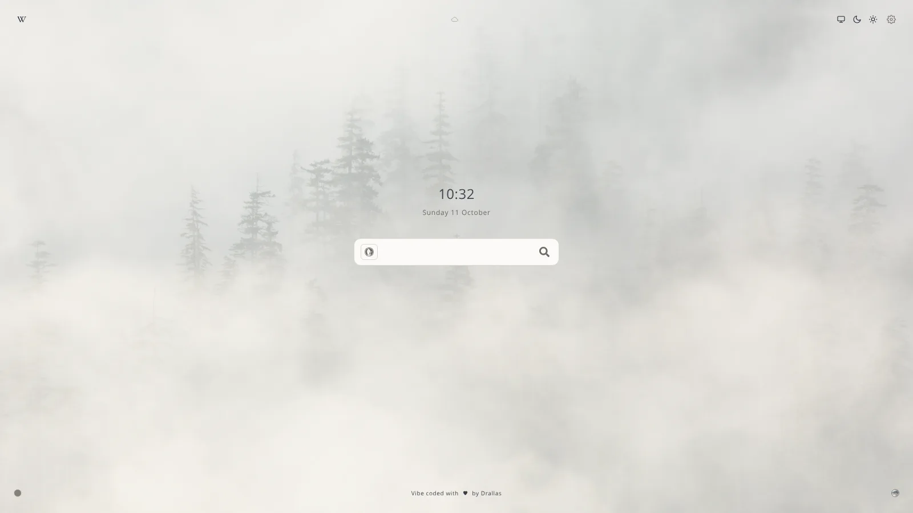
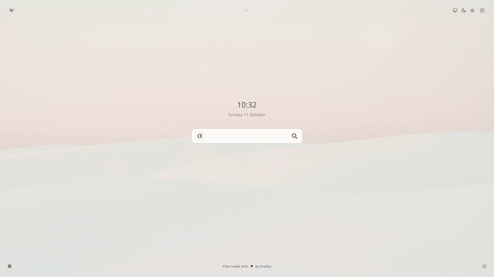
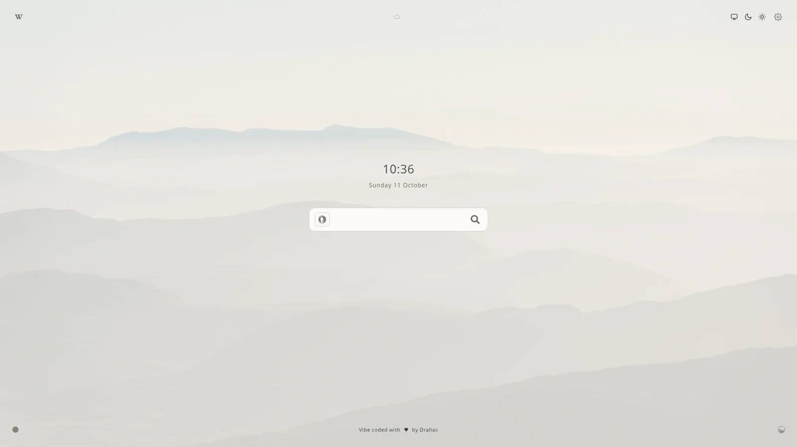
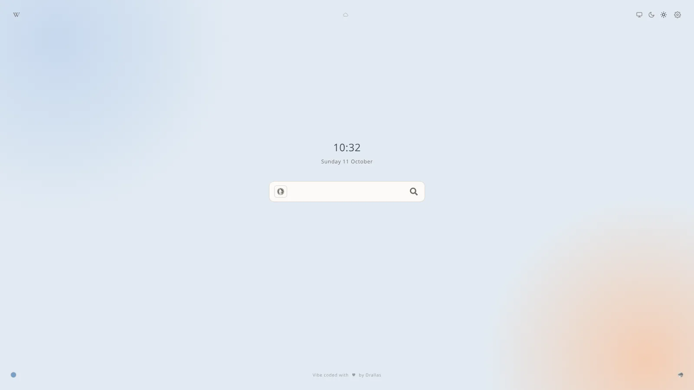
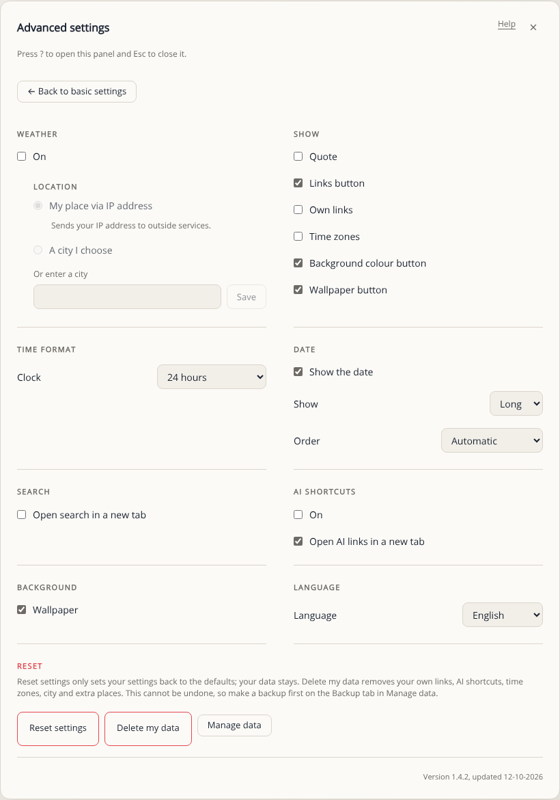
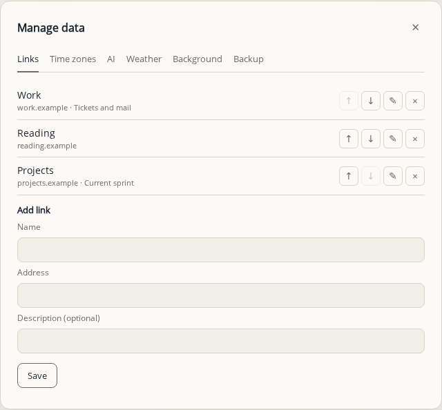

# Screenshots

The settings and data windows, for a quick look at what the page can do. The start page itself is at the top of the [README](../README.md).

## Backgrounds

The page has three kinds of background: a picture, or no picture with a soft colour. The round button bottom right goes through the pictures you switched on under Manage data, and the button bottom left changes the colour behind them. Pick the pictures you like and leave the rest off; the page never shows a picture you did not choose.

<table>
  <tr>
    <td align="center" width="25%">
      
       
      <b>Misty forest</b>
    </td>
    <td align="center" width="25%">
      
       
      <b>Pink dunes</b>
    </td>
    <td align="center" width="25%">
      
       
      <b>Mountain haze</b>
    </td>
    <td align="center" width="25%">
      
       
      <b>No image, blue tint</b>
    </td>
  </tr>
</table>

## Advanced settings

Every option, in groups. Weather, Show, Time format, Date, Search, AI shortcuts, Background and Language sit above the reset options. The reset section is at the bottom, in red: a backup comes first, through Manage data.

## Manage data

Your links, time zones, AI shortcuts and weather places. Each list shows its add form; at the limit that form says so, for example "5 of 5 · full", and the add button is greyed out.

